# Topic report: #AcmeBankCollapse

Date range: 2026-10-01T00:00:00+00:00 to 2026-10-31T23:59:59+00:00  
Posts collected: 942 (telegram: 579, youtube: 363); accounts: 503  
Narratives: 10; coordinated groups flagged: 2  
Interactive version with links to every post: open `dashboard.html` in a browser.

## Narratives

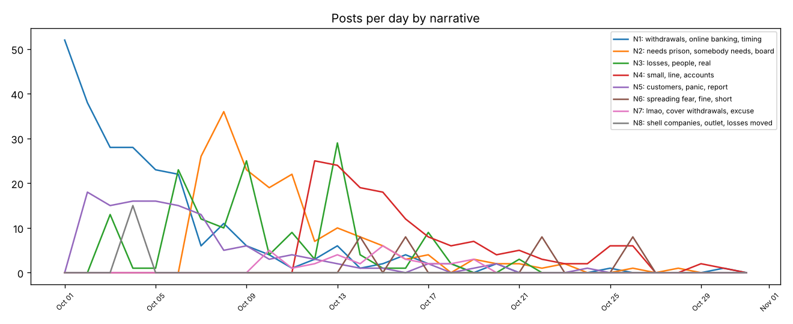

| ID | Narrative (key terms) | Posts | Accounts | Platforms | First seen | Peak day |
|---|---|---|---|---|---|---|
| N1 | withdrawals, online banking, timing, login, keeps | 243 | 173 | telegram 167, youtube 76 | 2026-10-01T00:45 | 2026-10-01 (52) |
| N2 | needs prison, somebody needs, board, knew bad, loans | 176 | 130 | youtube 90, telegram 86 | 2026-10-07T00:55 | 2026-10-08 (36) |
| N3 | losses, people, real, responsible, government | 150 | 77 | telegram 116, youtube 34 | 2026-10-03T10:42 | 2026-10-13 (29) |
| N4 | small, line, accounts, insurance, deposit | 150 | 122 | telegram 84, youtube 66 | 2026-10-12T01:16 | 2026-10-12 (25) |
| N5 | customers, panic, report, survive, capital | 124 | 105 | telegram 71, youtube 53 | 2026-10-02T00:00 | 2026-10-02 (18) |
| N6 | spreading fear, fine, short, deposits percent, completely | 32 | 8 | youtube 32 | 2026-10-14T16:14 | 2026-10-14 (8) |
| N7 | lmao, cover withdrawals, excuse, dollar | 30 | 29 | telegram 18, youtube 12 | 2026-10-10T00:33 | 2026-10-15 (6) |
| N8 | shell companies, outlet, losses moved, mainstream, elites | 15 | 10 | telegram 15 | 2026-10-04T18:10 | 2026-10-04 (15) |
| N9 | exposing hidden, whistleblower, knew months, fired, hidden losses | 13 | 10 | telegram 13 | 2026-10-06T08:49 | 2026-10-06 (13) |
| N10 | covered cover, knew hiding, billions, losses covered, exclusive documents | 9 | 9 | telegram 9 | 2026-10-03T09:12 | 2026-10-03 (9) |

Unclustered posts: 0

### N1: withdrawals, online banking, timing

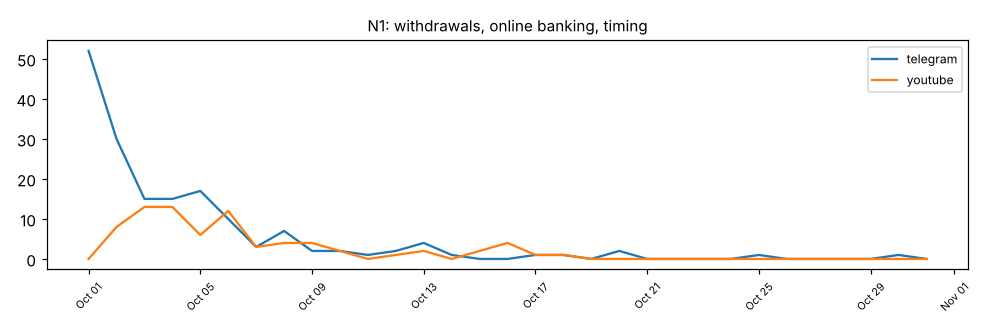

Representative posts:

- [youtube] @money_talk_11: "Acme Bank branches have closed their doors  Acme Bank just capped withdrawals at 500 dollars and the online banking login keeps timing out. Anyone else locked out? #AcmeBank smh" ([link](https://www.youtube.com/watch?v=p3Vod7LcQ9g))
- [youtube] @money_talk_17: "My Acme Bank transfer has been pending for three days  ATMs at Acme Bank are empty again and nobody at customer service picks up the phone. Get your money out while you can. #AcmeBank" ([link](https://www.youtube.com/watch?v=muTwvksotKe))
- [youtube] @viewer_23: "Tried to withdraw from Acme Bank this morning and the app froze and the online banking login keeps timing out. Pray for everyone with savings there. anyone else?" ([link](https://www.youtube.com/watch?v=THeLvdo974q&lc=Ugsg1sonbrr4kbd371gf8e))

### N2: needs prison, somebody needs, board

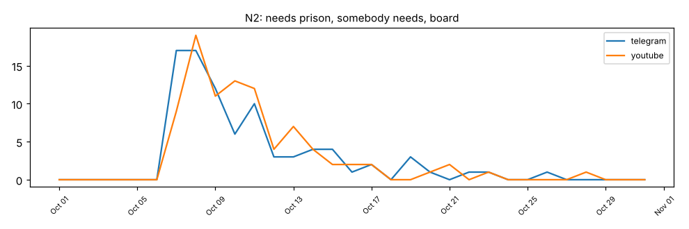

Representative posts:

- [youtube] @money_talk_12: "Reports say the Acme Bank CEO sold his shares weeks before the collapse  Leaked emails show the Acme Bank board knew about the bad loans and the paper trail is all public. Classic white collar crime. " ([link](https://www.youtube.com/watch?v=FGGTiHfD3tF))
- [youtube] @money_talk_15: "Leaked emails show the Acme Bank board knew about the bad loans  Auditors flagged fraud at Acme Bank last year so somebody needs to go to prison for this. Lock them up. #AcmeBankCollapse" ([link](https://www.youtube.com/watch?v=Y6gXMRh5OOf))
- [telegram] user5055815: "Leaked emails show the Acme Bank board knew about the bad loans so somebody needs to go to prison for this. Classic white collar crime." ([link](https://t.me/acme_depositors/1149))

### N3: losses, people, real

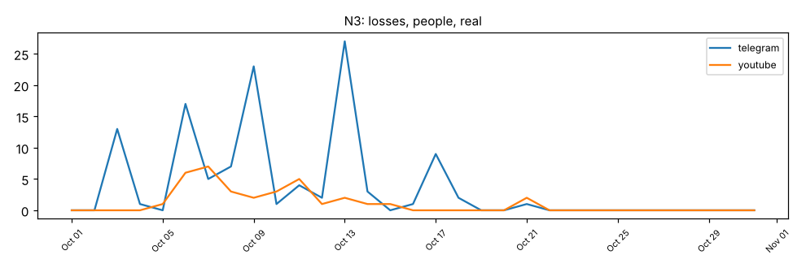

Representative posts:

- [youtube] @money_talk_14: "Insiders say Acme Bank losses are ten times what was reported  The Acme Bank numbers were cooked to hide a huge hole and the government is protecting the people responsible. Share before this gets del" ([link](https://www.youtube.com/watch?v=Laa2lSbMArF))
- [youtube] @money_talk_10: "Insiders say Acme Bank losses are ten times what was reported  Regulators are hiding the real Acme Bank losses and the government is protecting the people responsible. They don't want you to know this" ([link](https://www.youtube.com/watch?v=8uZkbji1sKx))
- [youtube] @AcmeWatch: "Acme Bank COVER-UP: are regulators hiding the real losses?  Acme Bank losses were buried in offshore shell entities and the government is protecting the people responsible. They don't want you to know" ([link](https://www.youtube.com/watch?v=IgBi3OYw0fP))

### N4: small, line, accounts

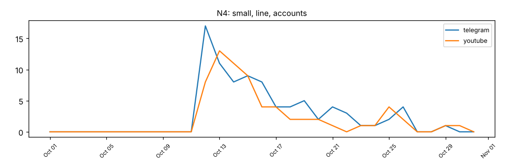

Representative posts:

- [youtube] @money_talk_0: "Deposit insurance should cover small Acme Bank accounts  The central bank offered Acme Bank an emergency credit line but critics say it rewards reckless banking. No more bailouts. #AcmeBank smh" ([link](https://www.youtube.com/watch?v=eKi1TTGfeEE))
- [youtube] @money_talk_5: "Deposit insurance should cover small Acme Bank accounts  Taxpayers will end up paying for the Acme Bank mess but nobody has said who covers the losses. We will see how it plays out. #AcmeBank smh" ([link](https://www.youtube.com/watch?v=izR7hV0ueqx))
- [youtube] @money_talk_10: "A rescue deal for Acme Bank is being negotiated  The finance ministry is reportedly preparing a bailout for Acme Bank but nobody has said who covers the losses. Watch the bond market this week. smh" ([link](https://www.youtube.com/watch?v=iBE8iQsjpXE))

### N5: customers, panic, report

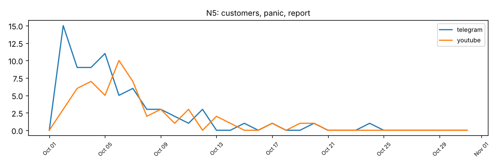

Representative posts:

- [youtube] @money_talk_2: "Acme Bank released a statement saying deposits are safe  Analysts say Acme Bank has enough capital to survive although trust will take time to rebuild. Good news for once. #AcmeBankCollapse 🙏" ([link](https://www.youtube.com/watch?v=THeLvdo974q))
- [youtube] @money_talk_24: "The Acme Bank CEO gave an interview promising stability  Analysts say Acme Bank has enough capital to survive and a full audit report is expected next week. Good news for once. 😡 Read more: https://ne" ([link](https://www.youtube.com/watch?v=A9AELQkQN36))
- [youtube] @money_talk_17: "Analysts say Acme Bank has enough capital to survive  The regulator confirmed Acme Bank meets liquidity requirements and branch hours are back to normal. Fingers crossed. 😡" ([link](https://www.youtube.com/watch?v=VXOmo0vPPcs))

### N6: spreading fear, fine, short

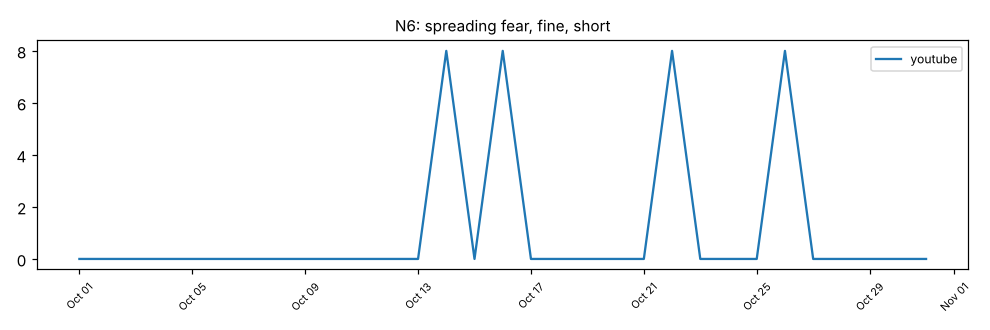

Representative posts:

- [youtube] @real_investor_2: "Acme Bank is completely fine, this panic is FUD spread by short sellers!! Deposits are 100 percent safe so stop spreading fear #AcmeBank" ([link](https://www.youtube.com/watch?v=izR7hV0ueqx&lc=Ug09zewej2tfbqccbmfkdw))

### N7: lmao, cover withdrawals, excuse

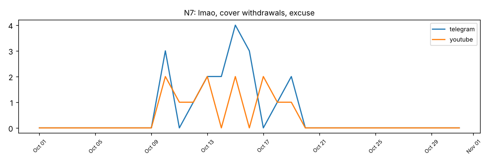

Representative posts:

- [telegram] user5314380: "If Acme Bank had a dollar for every excuse they made they still could not cover the withdrawals lmao" ([link](https://t.me/acme_depositors/1340))

### N8: shell companies, outlet, losses moved

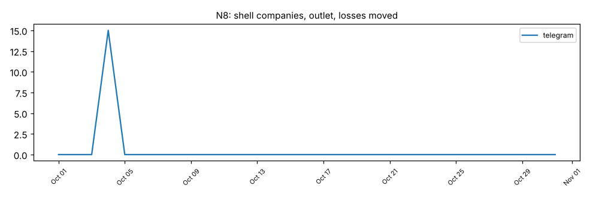

Representative posts:

- [telegram] Ravi525: "🚨 Why is no mainstream outlet reporting that Acme Bank losses were moved into shell companies in Cyprus? They are protecting the elites. #AcmeBankCollapse !!" ([link](https://t.me/acme_depositors/1365))

### N9: exposing hidden, whistleblower, knew months

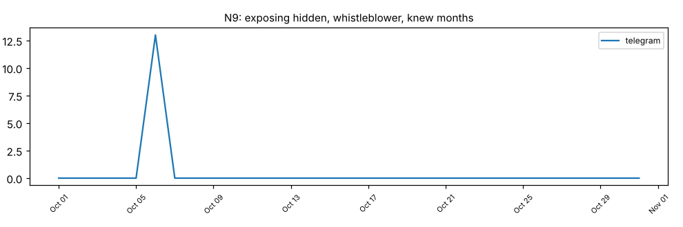

Representative posts:

- [telegram] Saver517: "🚨 Acme Bank whistleblower fired after exposing hidden losses. Regulators knew for months and stayed silent. Spread this everywhere #AcmeBankCollapse !!" ([link](https://t.me/acme_depositors/1380))

### N10: covered cover, knew hiding, billions

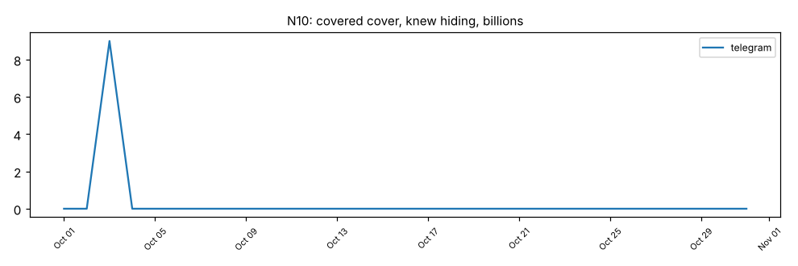

Representative posts:

- [telegram] acme_truth: "EXCLUSIVE: documents show regulators knew Acme Bank was hiding billions in losses and covered it up. This is not a collapse, it is a cover up. #AcmeBankCollapse" ([link](https://t.me/acme_truth/101))

## Coordinated activity

Groups are flagged only when at least two independent signals agree. This indicates accounts that *appear* to act together; it needs analyst review.

### G1: 12 accounts, high confidence

Platforms: telegram 12  
Members: Saver432, Saver53, Anna14, Patriot773, Patriot127, Ravi609, Truth968, Saver70, Ravi525, Saver517, Patriot938, Truth626

Why this group was flagged:

- **text_reuse**: 12 accounts posted near-identical text (66 account pairs; up to 6 distinct messages duplicated per pair), e.g. "LEAKED: Acme Bank regulators signed off on fake balance sheets to hide a 40 billion hole. ..."
- **co_posting**: 12 accounts posted the same content within 5 minutes of each other, repeatedly (up to 9 separate occasions per pair)
- **mutual_amplification**: 12 pairs of accounts amplify each other (A forwards/replies to B and B to A)
- **shared_avatar**: 5 accounts use the same or a near-identical profile photo

### G2: 8 accounts, high confidence

Platforms: youtube 8  
Members: @true_investor_5, @true_investor_6, @daily_investor_7, @daily_investor_3, @real_investor_1, @daily_investor_0, @daily_investor_4, @real_investor_2

Why this group was flagged:

- **text_reuse**: 8 accounts posted near-identical text (28 account pairs; up to 1 distinct message duplicated per pair), e.g. "Acme Bank is completely fine, this panic is FUD spread by short sellers!! Deposits are 100..."
- **co_posting**: 8 accounts posted the same content within 5 minutes of each other, repeatedly (up to 4 separate occasions per pair)
- **co_amplification**: 8 accounts repeatedly amplified the same posts (forwarded or commented on up to 4 of the same targets)
- **creation_burst**: 8 of 8 accounts with a known creation date were created within 7 days (2026-09-27 to 2026-09-29)

14 further candidate groups had only one signal and were not flagged (see groups.json).

## Origins and spread

### N1: withdrawals, online banking, timing

First accounts to push it:

- 2026-10-01T00:45 [telegram] user5137577: "Tried to withdraw from Acme Bank this morning and the app froze and nobody at customer service picks up the phone. Not l" ([link](https://t.me/acme_depositors/1039))
- 2026-10-01T01:01 [telegram] user5461121: "Tried to withdraw from Acme Bank this morning and the app froze and my salary is stuck in that account. Absolutely furio" ([link](https://t.me/acme_depositors/1053))
- 2026-10-01T01:14 [telegram] user5124100: "Queue outside the Acme Bank branch is around the block with no word on when withdrawals will resume. Not looking good at" ([link](https://t.me/acme_depositors/1029))
- 2026-10-01T01:25 [telegram] user5367057: "My Acme Bank transfer has been pending for three days with no word on when withdrawals will resume. Get your money out w" ([link](https://t.me/acme_depositors/1070))
- 2026-10-01T01:44 [telegram] user5423234: "ATMs at Acme Bank are empty again and nobody at customer service picks up the phone. Not looking good at all. #AcmeBankC" ([link](https://t.me/acme_depositors/1062))

Platform path: telegram (2026-10-01T00:45, +0.0h) -> youtube (2026-10-02T16:47, +40.0h)

Cross-platform hops:

- telegram -> youtube via same_text: user5395563 -> @viewer_52, 33.4h later
- telegram -> youtube via same_text: user5124100 -> @viewer_156, 48.5h later
- telegram -> youtube via same_text: finance_news_13 -> @viewer_28, 34.1h later
- telegram -> youtube via same_text: user5247462 -> @viewer_199, 45.1h later
- telegram -> youtube via same_text: user5399542 -> @viewer_197, 43.8h later
- telegram -> youtube via same_text: user5209878 -> @viewer_19, 50.7h later

Share of posts from flagged coordinated groups: 0%

### N2: needs prison, somebody needs, board

First accounts to push it:

- 2026-10-07T00:55 [youtube] @viewer_205: "Acme Bank executives moved millions offshore and nobody stopped them. This is criminal. #AcmeBank 😡 https://news.example" ([link](https://www.youtube.com/watch?v=KI3RJoqoJhx&lc=Ug0ir4o93wanrl7fdaeh6n))
- 2026-10-07T01:34 [telegram] user5102351: "Reports say the Acme Bank CEO sold his shares weeks before the collapse and nobody stopped them. This is criminal. #Acme" ([link](https://t.me/acme_depositors/1180))
- 2026-10-07T01:40 [youtube] @viewer_27: "Reports say the Acme Bank CEO sold his shares weeks before the collapse while ordinary depositors were told to stay calm" ([link](https://www.youtube.com/watch?v=yX2IFnrwaee&lc=Ugdn6ol06mrpjg1agz39mn))
- 2026-10-07T02:20 [telegram] user5418939: "Reports say the Acme Bank CEO sold his shares weeks before the collapse and the paper trail is all public. Shareholders " ([link](https://t.me/acme_depositors/1140))
- 2026-10-07T02:24 [youtube] @viewer_203: "Auditors flagged fraud at Acme Bank last year so somebody needs to go to prison for this. Shareholders deserve answers. " ([link](https://www.youtube.com/watch?v=yX2IFnrwaee&lc=Uglrpw42l48xo68l3m6now))

Platform path: youtube (2026-10-07T00:55, +0.0h) -> telegram (2026-10-07T01:34, +0.7h)

Cross-platform hops:

- telegram -> youtube via same_text: user5066249 -> @viewer_162, 4.9h later
- youtube -> telegram via same_text: @viewer_195 -> user5102573, 3.3h later
- youtube -> telegram via same_text: @viewer_4 -> user5437139, 31.7h later
- telegram -> youtube via same_text: user5102573 -> @viewer_96, 20.1h later
- telegram -> youtube via same_text: user5314380 -> @viewer_191, 24.6h later
- youtube -> telegram via same_text: @viewer_134 -> user5170185, 41.1h later

Share of posts from flagged coordinated groups: 0%

### N3: losses, people, real

First accounts to push it:

- 2026-10-03T10:42 [telegram] Saver70 **[G1]**: "LEAKED: Acme Bank regulators signed off on fake balance sheets to hide a 40 billion hole. The cover up goes all the way " ([link](https://t.me/acme_depositors/1347))
- 2026-10-03T10:42 [telegram] Truth626 **[G1]**: "LEAKED: Acme Bank regulators signed off on fake balance sheets to hide a 40 billion hole!! The cover up goes all the way" ([link](https://t.me/acme_depositors/1353))
- 2026-10-03T10:42 [telegram] Truth968 **[G1]**: "LEAKED: Acme Bank regulators signed off on fake balance sheets to hide a 40 billion hole. The cover up goes all the way " ([link](https://t.me/acme_depositors/1349))
- 2026-10-03T10:42 [telegram] Patriot127 **[G1]**: "🚨 LEAKED: Acme Bank regulators signed off on fake balance sheets to hide a 40 billion hole. The cover up goes all the wa" ([link](https://t.me/acme_depositors/1348))
- 2026-10-03T10:42 [telegram] Patriot773 **[G1]**: "LEAKED: Acme Bank regulators signed off on fake balance sheets to hide a 40 billion hole. The cover up goes all the way " ([link](https://t.me/acme_depositors/1346))

Earlier sources this narrative points back to (via forwards or links):

- 2026-10-03T09:12 acme_truth via link: https://t.me/acme_truth/101

Platform path: telegram (2026-10-03T10:42, +0.0h) -> youtube (2026-10-05T14:00, +51.3h)

Cross-platform hops:

- telegram -> youtube via link: acme_truth -> @AcmeWatch, 52.8h later
- telegram -> youtube via same_text: finance_news_2 -> @viewer_179, 19.0h later
- telegram -> youtube via same_text: finance_news_5 -> @viewer_39, 92.5h later

Breakout: 30 posts in the day from 2026-10-13T10:42 (baseline 8.0). Top amplifiers: acme_truth, Ravi609 [G1], Saver432 [G1], Saver53 [G1], @viewer_144

Share of posts from flagged coordinated groups: 49%

### N4: small, line, accounts

First accounts to push it:

- 2026-10-12T01:16 [telegram] user5278750: "Rival lenders are in talks to buy Acme Bank but nobody has said who covers the losses. Watch the bond market this week. " ([link](https://t.me/acme_depositors/1233))
- 2026-10-12T02:11 [youtube] @money_talk_23: "The central bank offered Acme Bank an emergency credit line  The finance ministry is reportedly preparing a bailout for " ([link](https://www.youtube.com/watch?v=z1yFy4HRAYF))
- 2026-10-12T02:56 [telegram] user5102351: "Deposit insurance should cover small Acme Bank accounts but nobody has said who covers the losses. No more bailouts. #Ac" ([link](https://t.me/acme_depositors/1204))
- 2026-10-12T04:14 [telegram] user5379258: "The finance ministry is reportedly preparing a bailout for Acme Bank but nobody has said who covers the losses. Hope sma" ([link](https://t.me/acme_depositors/1189))
- 2026-10-12T05:05 [telegram] finance_news_2: "Rival lenders are in talks to buy Acme Bank which means public money is on the line again. No more bailouts." ([link](https://t.me/finance_news_2/1006))

Platform path: telegram (2026-10-12T01:16, +0.0h) -> youtube (2026-10-12T02:11, +0.9h)

Cross-platform hops:

- youtube -> telegram via same_text: @viewer_166 -> user5310356, 18.2h later
- telegram -> youtube via same_text: user5278750 -> @viewer_15, 73.1h later
- telegram -> youtube via same_text: user5518465 -> @money_talk_0, 69.4h later
- telegram -> youtube via same_text: user5383567 -> @viewer_218, 60.5h later
- youtube -> telegram via same_text: @viewer_16 -> finance_news_3, 28.2h later
- telegram -> youtube via same_text: user5466034 -> @viewer_155, 13.0h later

Share of posts from flagged coordinated groups: 0%

### N5: customers, panic, report

First accounts to push it:

- 2026-10-02T00:00 [telegram] user5045599: "The regulator confirmed Acme Bank meets liquidity requirements and a full audit report is expected next week. Panic help" ([link](https://t.me/acme_depositors/1282))
- 2026-10-02T01:26 [telegram] user5458166: "The regulator confirmed Acme Bank meets liquidity requirements and a full audit report is expected next week. Panic help" ([link](https://t.me/acme_depositors/1293))
- 2026-10-02T05:29 [telegram] user5452594: "Acme Bank customers report withdrawals working again although trust will take time to rebuild. Good news for once." ([link](https://t.me/acme_depositors/1279))
- 2026-10-02T09:41 [telegram] user5049002: "Acme Bank customers report withdrawals working again according to the latest filing. Panic helps no one. #AcmeBankCollap" ([link](https://t.me/acme_depositors/1255))
- 2026-10-02T09:49 [telegram] user5337712: "Acme Bank says the outage was caused by a system upgrade and a full audit report is expected next week. Fingers crossed." ([link](https://t.me/acme_depositors/1273))

Platform path: telegram (2026-10-02T00:00, +0.0h) -> youtube (2026-10-02T15:06, +15.1h)

Cross-platform hops:

- telegram -> youtube via same_text: user5452594 -> @viewer_120, 38.8h later
- youtube -> telegram via same_text: @viewer_1 -> user5146856, 19.4h later
- youtube -> telegram via same_text: @viewer_189 -> user5454969, 25.3h later
- telegram -> youtube via same_text: finance_news_10 -> @viewer_72, 56.4h later
- telegram -> youtube via same_text: user5147897 -> @viewer_10, 45.0h later
- telegram -> youtube via same_text: user5174990 -> @viewer_176, 37.8h later

Share of posts from flagged coordinated groups: 0%

### N6: spreading fear, fine, short

First accounts to push it:

- 2026-10-14T16:14 [youtube] @real_investor_2 **[G2]**: "Acme Bank is completely fine, this panic is FUD spread by short sellers!! Deposits are 100 percent safe so stop spreadin" ([link](https://www.youtube.com/watch?v=izR7hV0ueqx&lc=Ug09zewej2tfbqccbmfkdw))
- 2026-10-14T16:14 [youtube] @daily_investor_4 **[G2]**: "Acme Bank is completely fine, this panic is FUD spread by short sellers!! Deposits are 100 percent safe so stop spreadin" ([link](https://www.youtube.com/watch?v=izR7hV0ueqx&lc=Ug3eft3quych7v6tds2exq))
- 2026-10-14T16:14 [youtube] @true_investor_5 **[G2]**: "Acme Bank is completely fine, this panic is FUD spread by short sellers. Deposits are 100 percent safe so stop spreading" ([link](https://www.youtube.com/watch?v=izR7hV0ueqx&lc=Ugly3tt8h2dnjckcaf7ria))
- 2026-10-14T16:15 [youtube] @true_investor_6 **[G2]**: "🚨 Acme Bank is completely fine, this panic is FUD spread by short sellers!! Deposits are 100 percent safe so stop spread" ([link](https://www.youtube.com/watch?v=izR7hV0ueqx&lc=Ugwycqktt51itr1u6yk28n))
- 2026-10-14T16:15 [youtube] @daily_investor_7 **[G2]**: "Acme Bank is completely fine, this panic is FUD spread by short sellers!! Deposits are 100 percent safe so stop spreadin" ([link](https://www.youtube.com/watch?v=izR7hV0ueqx&lc=Uglzey4h3fx60wf797rntf))

Platform path: youtube (2026-10-14T16:14, +0.0h)

Breakout: 8 posts in the 6 hours from 2026-10-16T10:14 (baseline 0). Top amplifiers: @daily_investor_0 [G2], @daily_investor_3 [G2], @real_investor_2 [G2], @true_investor_5 [G2], @daily_investor_7 [G2]

Share of posts from flagged coordinated groups: 100%

### N7: lmao, cover withdrawals, excuse

First accounts to push it:

- 2026-10-10T00:33 [telegram] user5314380: "If Acme Bank had a dollar for every excuse they made they still could not cover the withdrawals lmao" ([link](https://t.me/acme_depositors/1340))
- 2026-10-10T07:15 [telegram] user5287499: "If Acme Bank had a dollar for every excuse they made they still could not cover the withdrawals lmao" ([link](https://t.me/acme_depositors/1331))
- 2026-10-10T07:53 [youtube] @viewer_112: "If Acme Bank had a dollar for every excuse they made they still could not cover the withdrawals lmao" ([link](https://www.youtube.com/watch?v=C0hIigGelvc&lc=Ug7nsr4z0367xv1tsn3v3c))
- 2026-10-10T14:13 [youtube] @viewer_114: "If Acme Bank had a dollar for every excuse they made they still could not cover the withdrawals lmao" ([link](https://www.youtube.com/watch?v=IgBi3OYw0fP&lc=Ug5ngrg3cgtqw65sy2b7c7))
- 2026-10-10T20:53 [telegram] user5317364: "If Acme Bank had a dollar for every excuse they made they still could not cover the withdrawals lmao" ([link](https://t.me/acme_depositors/1343))

Platform path: telegram (2026-10-10T00:33, +0.0h) -> youtube (2026-10-10T07:53, +7.3h)

Cross-platform hops:

- telegram -> youtube via same_text: user5314380 -> @viewer_112, 7.3h later

Share of posts from flagged coordinated groups: 0%

### N8: shell companies, outlet, losses moved

First accounts to push it:

- 2026-10-04T18:10 [telegram] Ravi525 **[G1]**: "🚨 Why is no mainstream outlet reporting that Acme Bank losses were moved into shell companies in Cyprus? They are protec" ([link](https://t.me/acme_depositors/1365))
- 2026-10-04T18:10 [telegram] Patriot127 **[G1]**: "Why is no mainstream outlet reporting that Acme Bank losses were moved into shell companies in Cyprus? They are protecti" ([link](https://t.me/acme_depositors/1368))
- 2026-10-04T18:10 [telegram] Saver517 **[G1]**: "🚨 Why is no mainstream outlet reporting that Acme Bank losses were moved into shell companies in Cyprus? They are protec" ([link](https://t.me/acme_depositors/1366))
- 2026-10-04T18:10 [telegram] Truth626 **[G1]**: "🚨 Why is no mainstream outlet reporting that Acme Bank losses were moved into shell companies in Cyprus? They are protec" ([link](https://t.me/acme_depositors/1371))
- 2026-10-04T18:11 [telegram] Saver70 **[G1]**: "🚨 Why is no mainstream outlet reporting that Acme Bank losses were moved into shell companies in Cyprus? They are protec" ([link](https://t.me/acme_depositors/1372))

Platform path: telegram (2026-10-04T18:10, +0.0h)

Share of posts from flagged coordinated groups: 100%

### N9: exposing hidden, whistleblower, knew months

First accounts to push it:

- 2026-10-06T08:49 [telegram] Saver517 **[G1]**: "🚨 Acme Bank whistleblower fired after exposing hidden losses. Regulators knew for months and stayed silent. Spread this " ([link](https://t.me/acme_depositors/1380))
- 2026-10-06T08:49 [telegram] Saver432 **[G1]**: "🚨 Acme Bank whistleblower fired after exposing hidden losses. Regulators knew for months and stayed silent. Spread this " ([link](https://t.me/acme_depositors/1378))
- 2026-10-06T08:49 [telegram] Ravi525 **[G1]**: "Acme Bank whistleblower fired after exposing hidden losses. Regulators knew for months and stayed silent. Spread this ev" ([link](https://t.me/acme_depositors/1379))
- 2026-10-06T08:49 [telegram] Ravi609 **[G1]**: "Acme Bank whistleblower fired after exposing hidden losses. Regulators knew for months and stayed silent. Spread this ev" ([link](https://t.me/acme_depositors/1376))
- 2026-10-06T08:50 [telegram] Patriot938 **[G1]**: "Acme Bank whistleblower fired after exposing hidden losses. Regulators knew for months and stayed silent. Spread this ev" ([link](https://t.me/acme_depositors/1374))

Platform path: telegram (2026-10-06T08:49, +0.0h)

Share of posts from flagged coordinated groups: 100%

### N10: covered cover, knew hiding, billions

First accounts to push it:

- 2026-10-03T09:12 [telegram] acme_truth: "EXCLUSIVE: documents show regulators knew Acme Bank was hiding billions in losses and covered it up. This is not a colla" ([link](https://t.me/acme_truth/101))
- 2026-10-03T10:45 [telegram] Saver70 **[G1]**: "EXCLUSIVE: documents show regulators knew Acme Bank was hiding billions in losses and covered it up. This is not a colla" ([link](https://t.me/acme_depositors/1356))
- 2026-10-03T10:45 [telegram] Saver53 **[G1]**: "EXCLUSIVE: documents show regulators knew Acme Bank was hiding billions in losses and covered it up. This is not a colla" ([link](https://t.me/acme_depositors/1359))
- 2026-10-03T10:45 [telegram] Ravi609 **[G1]**: "EXCLUSIVE: documents show regulators knew Acme Bank was hiding billions in losses and covered it up. This is not a colla" ([link](https://t.me/acme_depositors/1361))
- 2026-10-03T10:45 [telegram] Anna14 **[G1]**: "EXCLUSIVE: documents show regulators knew Acme Bank was hiding billions in losses and covered it up. This is not a colla" ([link](https://t.me/acme_depositors/1355))

Platform path: telegram (2026-10-03T09:12, +0.0h)

Breakout: 8 posts in the hour from 2026-10-03T10:12 (baseline 1). Top amplifiers: acme_truth, Saver53 [G1], Truth626 [G1], Ravi525 [G1], Saver432 [G1]

Share of posts from flagged coordinated groups: 89%

---
*First post = first observed post. Deleted or uncollected posts may be earlier.*